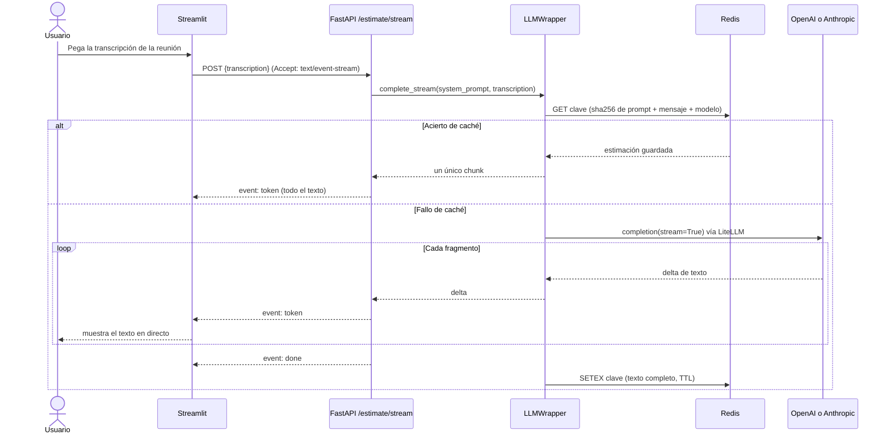
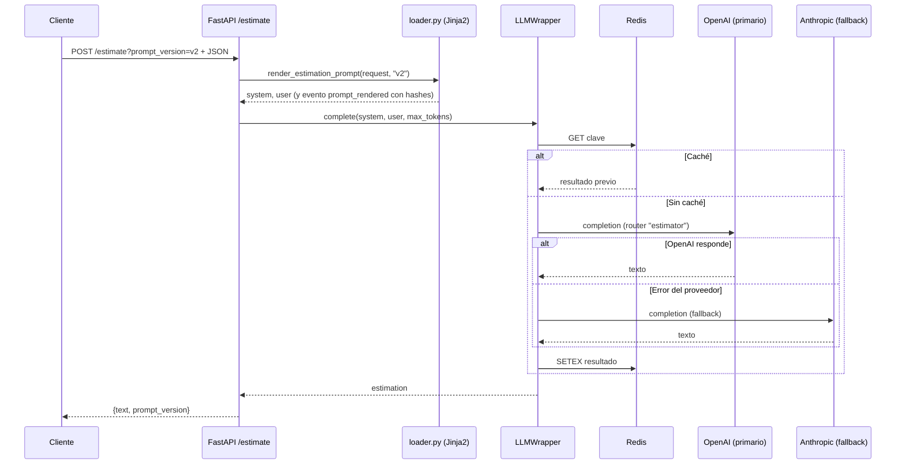

# Estimador CAG: documentación del proyecto

Este documento describe cómo está organizado el proyecto, cómo fluye una petición desde el front hasta el LLM (OpenAI o Anthropic) y qué piezas están todavía a medio conectar.

## Visión general

El proyecto tiene tres capas: un front en Streamlit, un backend en FastAPI y un servicio de LLM que llama a los proveedores a través de LiteLLM. Redis guarda las respuestas repetidas para no volver a llamar al modelo.

```mermaid
flowchart LR
    U[Usuario] --> FE[Front: Streamlit<br/>app/streamlit_app.py]
    FE -- "HTTP POST + SSE<br/>/api/v1/estimate/stream" --> API[Backend: FastAPI<br/>app/routers/estimations.py]
    API --> PR[Plantillas Jinja2<br/>app/prompts/estimation/v1|v2]
    API --> LW[LLMWrapper<br/>app/services/llm_wrapper.py]
    LW --> RC[(Redis<br/>caché exacta, TTL)]
    LW --> RT[LiteLLM Router]
    RT -- "primario" --> OAI[OpenAI<br/>gpt-4o-mini]
    RT -- "fallback" --> ANT[Anthropic<br/>Claude Haiku]
```

## Estructura de carpetas

| Ruta | Función |
|------|---------|
| `app/main.py` | Crea la aplicación FastAPI e incluye el router. |
| `app/config.py` | Configuración leída de variables de entorno y `.env`. |
| `app/dependencies.py` | Fábricas de dependencias: caché Redis y `LLMWrapper`. |
| `app/routers/estimations.py` | Endpoints `/api/v1/estimate` y `/api/v1/estimate/stream`. |
| `app/schemas/estimation.py` | Modelos Pydantic de petición y respuesta, enums y `PromptVersion`. |
| `app/prompts/loader.py` | Renderiza las plantillas Jinja2 y emite el evento `prompt_rendered`. |
| `app/prompts/estimation/v1/` | Plantillas de la versión 1 del prompt. |
| `app/prompts/estimation/v2/` | Plantillas de la versión 2 (tono de revisor, ejemplos propios). |
| `app/services/llm_wrapper.py` | Cliente LLM: caché, fallback, coste y logs. |
| `app/services/llm_service.py` | Prompt fijo para el streaming y funciones auxiliares. |
| `app/services/cache.py` | Caché Redis con clave SHA-256. |
| `app/streamlit_app.py` | Interfaz de chat en Streamlit. |
| `app/tests/prompts/` | Tests de plantillas, validación y logging. |
| `tests/` | Tests de los endpoints. |

## Las dos rutas de la API

**POST `/api/v1/estimate`** es la ruta de formulario. Recibe un JSON con `description`, `project_type`, `detail_level`, `output_format` y, opcionalmente, `reference_projects`. El parámetro de consulta `?prompt_version=v1|v2` elige la plantilla (por defecto `v1`). El backend renderiza los prompts de sistema y de usuario con Jinja2, llama al `LLMWrapper` y devuelve `{text, prompt_version}`. Es una llamada síncrona: el cliente espera la respuesta completa.

**POST `/api/v1/estimate/stream`** es la ruta que usa el front. Recibe `transcription` y, opcionalmente, `model` y `max_tokens`. Responde con Server-Sent Events: envía eventos `token` según llegan del modelo y termina con `done` o `error`. Esta ruta **no usa las plantillas Jinja2 ni el parámetro de versión**: el prompt de sistema lo construye `build_system_prompt()` en `llm_service.py`, con texto fijo.

## Flujo de streaming (front → modelo)



## Flujo de la ruta POST con fallback

Esta ruta no usa streaming, así que espera la respuesta completa. Aquí se ve el fallback.



Si el LLM falla por completo, el endpoint responde HTTP 500 con el mensaje del error.

## Cómo se llama a Anthropic

El código de negocio no llama a Anthropic directamente. `llm_wrapper.py` configura un `Router` de LiteLLM con dos despliegues bajo el mismo nombre `estimator`: el primario (OpenAI, `gpt-4o-mini` por defecto) y el fallback (Claude). Si el primario falla, LiteLLM reintenta con el de Anthropic.

Si la petición indica un `model` concreto, el wrapper evita el router y llama a `litellm.completion` directamente, con la clave del proveedor que corresponda.

La caché de Redis usa una clave SHA-256 que incluye el prompt de sistema, el mensaje del usuario, el modelo y los parámetros. Por eso cambiar de versión de prompt (v1 a v2) no mezcla respuestas, y una respuesta de un modelo no se reutiliza para otro.

## Sesiones multi-turno

Además de las peticiones aisladas, la API ofrece sesiones de varios turnos, pensadas para ir refinando una estimación a lo largo de una conversación. Están implementadas en `app/routers/sessions.py` y `app/services/sessions.py`, y el system prompt se renderiza desde `app/prompts/session/v1/system.j2`.

- **`POST /sessions`** crea una sesión y devuelve un `session_id` (UUID v4), con código 201.
- **`GET /sessions/{session_id}`** devuelve los `project_metadata`, el número de turnos que quedan en la ventana deslizante y el tamaño de esa ventana (`max_turns`). Responde 404 si la sesión no existe.
- **`POST /sessions/{session_id}/estimate`** recibe `multipart/form-data` con `transcript` (obligatorio) y `attachments` (opcional, varios archivos). Devuelve `{text, prompt_version}` con `prompt_version` fijado a `session-v1`.

Cada sesión guarda por separado los metadatos del proyecto y la ventana de turnos, y el mensaje enviado al modelo tiene la forma `[system, *historial, usuario]`. Los tests de esta funcionalidad están en `tests/test_sessions_unit.py` (sin red ni proveedor) y `tests/test_sessions_api.py` (integración con un LLM simulado).

## Estado actual y puntos pendientes

- **Configuración incompleta.** `dependencies.py` lee `PRIMARY_MODEL`, `FALLBACK_MODEL`, `OPENAI_API_KEY`, `REDIS_URL`, `LLM_TIMEOUT`, `LLM_RETRIES` y `CACHE_TTL`, pero `config.py` no las define. Una llamada real fallará antes de llegar al modelo.
- **Proveedor primario inconsistente.** `config.py` tiene `LLM_PROVIDER=anthropic` por defecto, mientras que el router trata OpenAI como primario. Conviene decidir uno de los dos y definirlo en la configuración.
- **Front y versiones de prompt.** El chat de Streamlit usa la ruta de streaming, que no aplica las plantillas v1/v2. Si se quiere la variante elegida en el front, habría que llevarla también al endpoint de streaming.
- **Importaciones rotas heredadas.** `app/services/evaluation.py` importa `StructureCheck` desde `schemas`, y ese nombre no existe. Ese módulo no está en la ruta de las peticiones, así que no bloquea la API.
- **Respuesta sin coste.** El wrapper calcula `cost_usd`, pero `EstimationResponse` solo devuelve `text` y `prompt_version`.

## Requisitos de Python

El proyecto requiere **Python 3.11 o superior** (`requires-python = ">=3.11"` en `pyproject.toml`). El entorno de desarrollo usa Python 3.13, fijado en `.python-version`.

Antes el campo declaraba `>=3.7`. Con ese rango, uv intentaba resolver las dependencias también para Python 3.7 y fallaba: las versiones recientes de `python-multipart` no son instalables en versiones antiguas (la 0.0.21 exige 3.10 y la 0.0.33 exige 3.11). Por eso `uv sync` devolvía el error *No solution found when resolving dependencies*. Subir el mínimo a 3.11 lo soluciona, y `uv.lock` se regenera al ejecutar `uv sync`.

## Cómo ejecutar

```powershell
uv sync
uv run pytest app/tests/prompts tests -v
uv run uvicorn app.main:app --reload
```

La documentación interactiva está en `http://127.0.0.1:8000/docs`. El front se arranca con `uv run streamlit run app/streamlit_app.py` y lee la URL de la API de la variable `ESTIMATOR_API_BASE_URL`.
